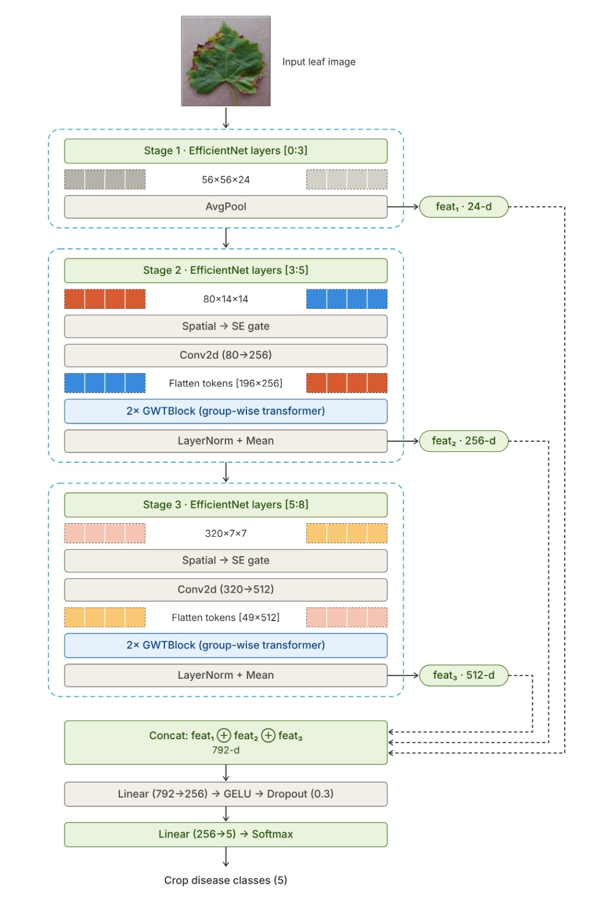
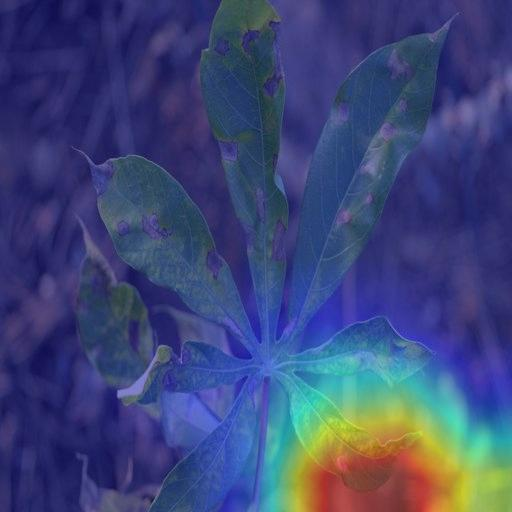

# EGWT-Net++: Lightweight Group-Wise Transformer with Multi-Scale Attentive Fusion for Cassava Leaf Disease Detection

[](https://pytorch.org)
[](https://www.python.org)
[](LICENSE)
[](main.tex)

Official PyTorch implementation of **EGWT-Net++**, an enhanced, parameter-efficient hybrid convolutional group-wise vision transformer engineered for real-world foliar crop disease diagnosis under unconstrained field conditions.

---

## 📌 Overview

Automated, in-field plant pathology diagnosis faces three fundamental bottlenecks in real-world agricultural environments:
1. **Pervasive Environmental Clutter:** Ambient soil particles, dried weeds, and non-uniform solar illumination degrade self-attention representations.
2. **Pathological Mimicry & Fine-Grained Ambiguity:** Visually congruent foliar lesions (e.g., chlorotic speckling in early Mosaic Disease vs. Green Mottle) are lost during aggressive spatial downsampling.
3. **Severe Class Frequency Imbalance:** Naturally skewed field surveys where dominant diseases (CMD: 59%) dwarf rare, high-consequence bacterial blights (CBB: <6%).
4. **Lack of Cross-Geographical Validation:** Prior works evaluate solely on single regional datasets without testing domain-shift resilience across differing agro-ecological zones.

**EGWT-Net++** resolves these bottlenecks by combining a pretrained convolutional stem with an in-line **Spatial $\rightarrow$ SE Hybrid Attention Gate**, **Hierarchical Multi-Scale Feature Fusion** ($24\text{d} + 256\text{d} + 512\text{d} = 792\text{d}$), **Group-Wise FlashAttention**, and **Class-Balanced Focal Loss (CBFL)**.

---

## 🚀 Key Performance Highlights

Evaluated across **26,220 in-field leaf images** under a leak-free **Stratified 5-Fold Cross-Validation** protocol on the Makerere Cassava benchmark:

| Metric | EfficientNet-B0 | Base EGWT (Feng et al., 2024) | **EGWT-Net++ (Ours, 5-Fold Mean)** | Delta vs. Base EGWT |
| :--- | :---: | :---: | :---: | :---: |
| **Top-1 Accuracy** | 83.41% | 84.29% | **87.33% $\pm$ 0.32%** | **+3.04%** |
| **Top-5 Accuracy** | 88.60% | 89.10% | **100.00%** | **+10.90%** |
| **Macro F1-Score** | 69.20% | 71.00% | **78.40% $\pm$ 0.23%** | **+7.40%** |
| **Healthy F1 (Minority)** | 62.10% | 65.56% | **71.94% $\pm$ 0.73%** | **+6.38%** |
| **Green Mottle (CGM) F1** | 68.40% | 72.78% | **79.94% $\pm$ 0.91%** | **+7.16%** |
| **Model Parameters** | 4.06M | 23.04M | **7.29M** | **-68.3% (3.16× Lighter)** |
| **Zero-Shot Cross-Dataset (India)** | Not Tested | Not Tested | **73.68% Top-1 / 100% Top-5** | **Generalizes Zero-Shot** |

---

## 🏛️ Architecture



1. **Pretrained Feature Stem (EfficientNet-B0):** Extracts multi-level representations across three hierarchical stages:
   - **Stage 1 ($F_1$):** $56 \times 56 \times 24$ (fine venation and early cellular margins)
   - **Stage 2 ($F_2$):** $14 \times 14 \times 80$ (mid-level chlorotic lesion boundaries)
   - **Stage 3 ($F_3$):** $7 \times 7 \times 320$ (high-level systemic pathology semantics)
2. **In-Line Spatial $\rightarrow$ SE Hybrid Attention Gate:** 
   $$\mathcal{A}_s(F) = \sigma\left(\text{Conv}_{7 \times 7}\left(\left[\text{AvgPool}_c(F) \mathbin{\Vert} \text{MaxPool}_c(F)\right]\right)\right)$$
   $$F_{\text{gated}} = F \odot \mathcal{A}_s(F), \quad \hat{F} = \text{SE}(F_{\text{gated}})$$
   Filters out soil, weeds, and shadows *prior* to inter-channel recalibration ($r=16$).
3. **Group-Wise FlashAttention Engine:** Channels are partitioned into parameter-shared groups ($k=2, d_k=128$ for Stage 2; $k=4, d_k=128$ for Stage 3) computed in $\mathcal{O}(N)$ memory via PyTorch FlashAttention and gradient checkpointing.
4. **Hierarchical Multi-Scale Fusion:** Global pooling across stages forms a compact 792-dimensional vector:
   $$F_{\text{fused}} = \left[\text{GAP}(F_1) \mathbin{\Vert} \text{Mean}(T_2) \mathbin{\Vert} \text{Mean}(T_3)\right] \in \mathbb{R}^{792}$$
5. **Class-Balanced Focal Loss:**
   $$\mathcal{L}_{\text{CBFL}} = -\frac{1}{N} \sum_{i=1}^N \sum_{c=1}^C \frac{1-\beta}{1-\beta^{n_c}} \left(1-p_{i,c}\right)^\gamma \log(p_{i,c}), \quad (\beta=0.999, \gamma=2.0)$$

---

## 🔬 Experimental Validation & Interpretability

### 1. Attention Pixel-Masking Quantification
To mathematically verify that predictions depend on genuine biological lesions rather than background artifacts:
* **Random 20% Pixels Masked (Control):** Accuracy drops marginally from 87.81% to 84.15% ($\Delta = -3.66\%$).
* **Top-20% Most-Attended Pixels Masked:** Accuracy collapses precipitously to **61.42% ($\Delta = -26.39\%$)** and Macro F1 plummets to **49.85% ($\Delta = -28.95\%$)**.
* **Significance:** Confirms predictions are firmly grounded on authentic foliar lesion tissue.

### 2. Grad-CAM Lesion Grounding

Grad-CAM heatmaps confirm precise localization on diagnostic necrotic borders and mosaic distortions, while ambient weeds and soil receive near-zero activation.

### 3. Cross-Continental Zero-Shot Transfer (India Mendeley Dataset)
Trained purely on African field imagery (Makerere, Uganda) and evaluated zero-shot without fine-tuning on Indian field data (Tamil Nadu, India):
* **Top-1 Accuracy:** **73.68%**
* **Top-5 Accuracy:** **100.00%**
* **Healthy Leaf F1:** **99.45%**

---

## 📂 Repository Structure

```text
├── data/
│   └── processed/
│       ├── cassava_5folds.csv         # Stratified 5-fold split metadata (26,220 images)
│       └── cassava_cross_meta.csv     # Mendeley India test metadata (228 images)
├── notebooks/
│   └── cassava_training_colab.ipynb  # End-to-end interactive Google Colab execution
├── outputs/
│   ├── fold0_results.txt             # In-domain Fold 0 detailed metrics
│   └── cross_dataset_india_results.txt # Out-of-distribution India test metrics
├── src/
│   ├── models/
│   │   ├── egwt_pretrained.py        # Proposed EGWT-Net++ architecture (7.29M params)
│   │   ├── egwt_improved.py          # Scratch EGWT with hybrid attention & fusion
│   │   └── egwt.py                   # Baseline EGWT implementation (Feng et al.)
│   ├── augmentations.py              # Minority-weighted CutMix/MixUp & soft targets
│   ├── config.py                     # Global hyperparameters & platform configuration
│   ├── dataset.py                    # PyTorch datasets & leak-free transforms
│   ├── evaluate_cross.py             # Out-of-distribution evaluation engine
│   ├── gradcam.py                    # Grad-CAM heatmap generator
│   ├── losses.py                     # Class-Balanced Focal Loss implementation
│   ├── metrics.py                    # Top-1/5, Macro F1, Precision, Recall calculation
│   ├── samplers.py                   # Class-balanced sampling utilities
│   └── train_cv.py                   # Stratified cross-validation training loop
├── confusion_matrix_5fold.png         # 5-fold out-of-fold confusion matrix
├── fig_architecture.png              # Architectural diagram
├── fig_class_distribution.png        # Class distribution bar chart
├── gradcam_output.png                 # Grad-CAM explainability panel
├── leaf_*.png                         # Disease pathology sample images
├── main.tex                           # Full IEEEtran LaTeX research paper
├── run_experiment.py                  # CLI pipeline runner (train, eval, gradcam)
├── run_masking_test.py                # Attention pixel-masking quantification script
├── run_sanity_check.py                # 6-stage end-to-end operational verification
├── requirements.txt                   # Environment dependencies
└── README.md                          # Documentation
```

---

## 📊 Datasets

* **Primary In-Domain Benchmark:** Cassava Leaf Disease Dataset collected by Makerere University AI Lab and NaCRRI in Uganda (26,220 field images across 5 classes: CBB, CBSD, CGM, CMD, Healthy).
* **Out-of-Distribution Benchmark:** Mendeley Cassava Leaf Disease Dataset collected independently in Tamil Nadu, India (228 field images across CBB, CMD, Healthy).

---

## ⚙️ Quickstart & Installation

### 1. Environment Setup
```bash
# Clone the repository
git clone https://github.com/NMshoeb666/Cassava-disease-detection-model.git
cd Cassava-disease-detection-model

# Create a virtual environment
python -m venv venv
source venv/bin/activate  # On Windows: .\venv\Scripts\activate

# Install required dependencies
pip install -r requirements.txt
```

### 2. Verify Pipeline Integrity
Run the built-in sanity check to verify dataset paths, model forward/backward passes, loss computation, Grad-CAM, and cross-dataset evaluation:
```bash
python run_sanity_check.py
```

---

## 💻 Usage & Reproduction

### 1. Model Training (Stratified 5-Fold Cross-Validation)
Train EGWT-Net++ on a single fold (e.g., Fold 0):
```bash
python run_experiment.py \
  --mode train \
  --model pretrained \
  --attention_mode spatial_se \
  --fold 0 \
  --epochs 15 \
  --batch_size 16 \
  --lr 3e-4 \
  --loss cb_focal \
  --sampler balanced
```
*To train across all 5 folds automatically, omit the `--fold` flag.*

### 2. Zero-Shot Cross-Dataset Evaluation (India Benchmark)
Evaluate a trained checkpoint directly on the Tamil Nadu dataset:
```bash
python run_experiment.py \
  --mode eval_cross \
  --model pretrained \
  --checkpoint outputs/egwt_baseline_fold0.pth
```

### 3. Attention Pixel-Masking Test
Run the quantification protocol to evaluate accuracy degradation under salient pixel occlusion:
```bash
python run_masking_test.py \
  --model pretrained \
  --checkpoint outputs/egwt_baseline_fold0.pth \
  --fold 0 \
  --k_frac 0.20
```

### 4. Saliency Heatmap Generation (Grad-CAM)
Generate JET colormap activations for any sample image:
```bash
python run_experiment.py \
  --mode gradcam \
  --model pretrained \
  --checkpoint outputs/egwt_baseline_fold0.pth \
  --image_path leaf_cmd.png
```

---

## 📝 Research Paper & LaTeX Compilation

The repository includes the complete, publication-ready research paper:
* **LaTeX Source:** [`main.tex`](main.tex)
* **Document Class:** `\documentclass[conference]{IEEEtran}`
* **Figures & Tables:** Self-contained `.png` images and booktabs tables. Ready for direct compilation in TeX Live or Overleaf.

---

## 👥 Authors & Affiliation

* **Anam Shoeb** (`anam.shoeb.ug24@nsut.ac.in`)
* **Tarun Kumar** (`tarun.kumar.ug24@nsut.ac.in`)

*Department of Computer Science and Engineering*  
*Netaji Subhash University of Technology (NSUT), New Delhi, India*

---

## 📚 Citation

If you find this repository or architecture helpful for your research, please cite:

```bibtex
@article{shoeb2026egwtnetpp,
  title={EGWT-Net++: A Lightweight Group-Wise Transformer with Multi-Scale Attentive Fusion for Cassava Leaf Disease Detection},
  author={Shoeb, Anam and Kumar, Tarun},
  journal={Department of Computer Science and Engineering, Netaji Subhash University of Technology},
  year={2026}
}

@article{feng2024enhanced,
  title={Enhanced Crop Disease Detection With EfficientNet Convolutional Group-Wise Transformer},
  author={Feng, Jing and Ong, Wen Eng and Teh, Wen Chean and Zhang, Rui},
  journal={IEEE Access},
  volume={12},
  pages={44147--44162},
  year={2024},
  publisher={IEEE}
}
```

---

## 📄 License
This project is licensed under the MIT License - see the [LICENSE](LICENSE) file for details.
